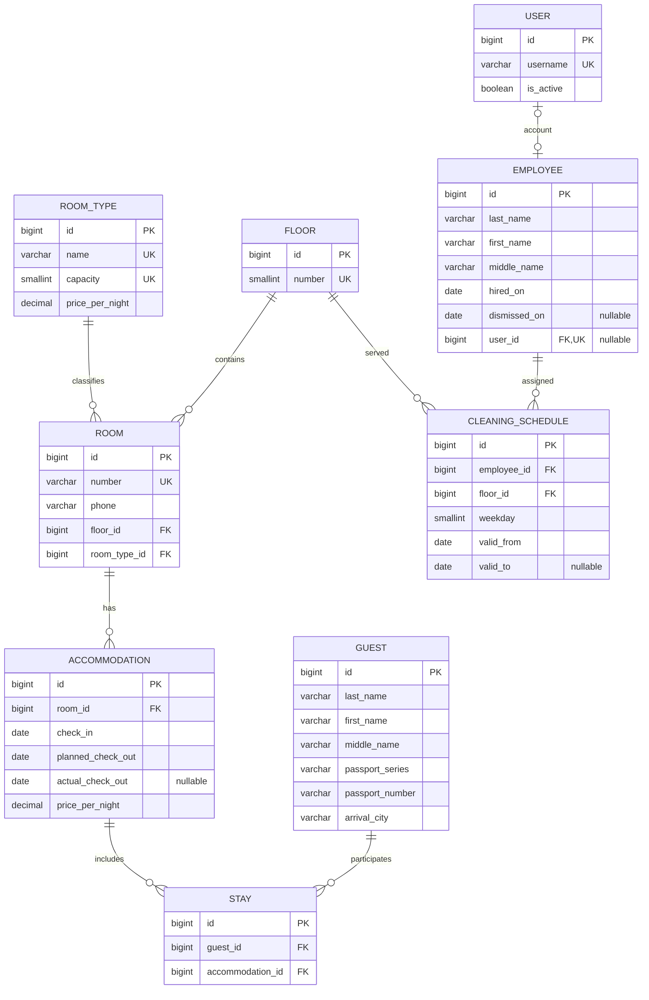

# Схема базы данных гостиницы — лабораторная №3

Вариант 1 «Администратор гостиницы». Одна гостиница, фиксированный номерной фонд.
Реализованы Django Models в `hotel_api/hotel_app/models.py`; целевая и единственная СУБД — PostgreSQL.
Документ заменяет предложение этапа 1: оплата теперь **за номер целиком**, независимого подселения разных групп нет.

## Модели и поля

Восемь предметных моделей: RoomType, Floor, Room, Guest, Accommodation, Stay, Employee, CleaningSchedule.
Стандартный User Django используется без собственной модели пользователя.
У всех моделей PK `id = BigAutoField(primary_key=True)`.
В таблице C(n) означает `CharField(max_length=n)`, D — DateField,
Money — `DecimalField(max_digits=10, decimal_places=2)` с MinValueValidator(0.01).
Остальные поля обязательные, если явно не указана необязательность.

| Модель | Поля и типы, помимо id | Ограничения |
| --- | --- | --- |
| RoomType | name C(30); capacity PositiveSmallIntegerField; price_per_night Money | name UNIQUE; capacity UNIQUE, choices 1/2/3 (Одноместный/Двухместный/Трёхместный), CHECK IN (1,2,3); цена CHECK >0 |
| Floor | number PositiveSmallIntegerField | UNIQUE; MinValueValidator(1), CHECK >=1 |
| Room | number C(10); phone C(30); floor FK; room_type FK | number UNIQUE; оба FK PROTECT |
| Guest | last_name C(100); first_name C(100); middle_name C(100, blank=True); passport_series C(10); passport_number C(20); arrival_city C(100) | UNIQUE(passport_series, passport_number) |
| Accommodation | room FK; check_in D; planned_check_out D; actual_check_out D(null=True, blank=True); price_per_night Money | FK PROTECT; плановый выезд > заезда; фактический NULL или > заезда; цена >0 |
| Stay | guest FK; accommodation FK | Оба FK PROTECT; UNIQUE(guest, accommodation) |
| Employee | last_name C(100); first_name C(100); middle_name C(100, blank=True); hired_on D; dismissed_on D(null=True, blank=True); user OneToOne; floors ManyToManyField | user nullable/blank, SET_NULL; увольнение NULL или >= приёма; floors через CleaningSchedule, blank=True |
| CleaningSchedule | employee FK; floor FK; weekday PositiveSmallIntegerField; valid_from D; valid_to D(null=True, blank=True) | FK PROTECT; weekday choices 0..6 и CHECK 0..6; valid_to NULL или > valid_from; UNIQUE(employee,floor,weekday,valid_from) |

Дни недели: 0 — понедельник, 1 — вторник, 2 — среда, 3 — четверг, 4 — пятница, 5 — суббота, 6 — воскресенье.
Телефон и паспорт — строки: ведущие нули и знак + сохраняются.
Для каждого значения capacity разрешена одна запись RoomType; name — человекочитаемое название.
Три типа предусмотрены choices и ограничениями, но записи справочника и цены автоматически не создаются.
Формат паспорта пока серия + номер, без проверки гражданства и органа выдачи.
Город прибытия по текущему заданию находится в Guest; это одно актуальное значение, без истории городов по заездам.

## Связи и related_name

| Поле | Вид связи | Обратное имя | Смысл |
| --- | --- | --- | --- |
| Room.room_type | RoomType 1:N Room | rooms | Общие вместимость и текущий тариф |
| Room.floor | Floor 1:N Room | rooms | Номера этажа |
| Accommodation.room | Room 1:N Accommodation | accommodations | История оплачиваемых периодов номера |
| Stay.accommodation | Accommodation 1:N Stay | stays | Гости одной группы |
| Stay.guest | Guest 1:N Stay | stays | Повторные заезды гостя |
| CleaningSchedule.employee | Employee 1:N CleaningSchedule | cleaning_assignments | Назначения сотрудника |
| CleaningSchedule.floor | Floor 1:N CleaningSchedule | cleaning_assignments | Назначения на этаж |
| Employee.floors | Employee M:N Floor | employees | Явная through=CleaningSchedule; автоматической второй таблицы нет |
| Employee.user | Необязательная User 1:1 Employee | employee | Аккаунт сотрудника через settings.AUTH_USER_MODEL |

Гость может существовать без аккаунта, сотрудник тоже. User может быть администратором без Employee.
Авторизация использует стандартного User, Djoser и токены DRF; сессии Django сохранены.
Список этажей сотрудника может содержать повторы из-за разных дней/периодов: при необходимости нужен distinct().
Все модели имеют __str__().

## ER-диаграмма

USER показан сокращённо. Employee M:N Floor раскрыта через CleaningSchedule.

## Accommodation и совместное проживание

Accommodation — один оплачиваемый период номера для группы с общими датами.
Несколько Stay не увеличивают тариф. Повторный заезд создаёт новую Accommodation
и новую Stay. Пара guest/accommodation уникальна.

При первом save без переданного тарифа копируется RoomType.price_per_night;
операция заселения явно фиксирует его на сервере. Последующие изменения цены
типа не пересчитывают историю. bulk_create не вызывает save и требует явного тарифа.

Интервал проживания `[check_in, check_out)`. Фактический выезд имеет приоритет,
при NULL используется плановый, как в services.overlapping_accommodations.
Плановая дата сама не заполняет actual_check_out: выселение оформляется отдельно.
Будущие заезды разрешены; день выезда не оплачивается и допускает новый заезд.

## Проверки и история

API проверяет вместимость, непустую группу без повторов, пересечения номера и
каждого гостя. Заселение/выселение выполняются в transaction.atomic с блокировками
гостей по ID, затем номера. Выселение заполняет actual_check_out, не удаляя историю.

Номер с историей нельзя переводить на другой этаж или тип, вместимость
используемого типа нельзя менять. Текущий тариф типа менять можно.
Гостиничные ForeignKey защищены PROTECT; удаление User оставляет Employee.user=NULL.

Расписание действует на `[valid_from, valid_to)`, NULL — открытый конец.
API проверяет даты, приём на работу и пересечение назначений для одной тройки
employee/floor/weekday. На этаж допускаются несколько разных сотрудников.
Изменение начавшегося назначения создаёт новую версию, закрывая старую.
Отмена будущего назначения удаляет его; начавшееся закрывается сегодняшней датой.
Завершённые назначения сохраняются.

Увольнение закрывает действующие назначения, удаляет будущие и деактивирует
связанный User. История сотрудника сохраняется. PATCH dismissed_on использует
тот же сервис. Увольнение в будущем и отмена состоявшегося увольнения запрещены.

В Django Admin Accommodation, Stay, CleaningSchedule, Room, RoomType и Employee
доступны только для просмотра, включая суперпользователя. Изменения идут через API.
Прямые записи доверенного разработчика через shell/ORM могут обходить API-проверки.

## Квартальный отчёт

GET `/api/reports/quarterly/?year=2026&quarter=4`, только is_staff=True.
Параметры проверяются Serializer: year 1–9998, quarter 1–4.
Кварталы `[01.01,01.04)`, `[01.04,01.07)`, `[01.07,01.10)`,
`[01.10,01.01 следующего года)`.

Пусть квартал `[Q0,Q1)`, E=actual_check_out или planned_check_out.
Число ночей: `max(0, (min(E,Q1) - max(check_in,Q0)).days)`.
Доход Accommodation: ночи × сохранённый price_per_night, вычисления Decimal.
Доход номера — сумма по его Accommodation; общий доход — сумма по номерам.
Цена не умножается на число Stay. Отчёт не обрезается сегодняшней датой,
включает плановые ночи при отсутствии фактического выезда и не является журналом платежей.

Гости номера — уникальные guest_id через Stay у пересекающих квартал Accommodation.
Повторные заезды увеличивают доход, но не количество уникальных гостей.
Все номера присутствуют, включая пустые с нулевыми показателями.
Все этажи присутствуют, число номеров вычисляется Count("rooms"), включая ноль.
Результат формируется при GET и не сохраняется в базе.

## API и доступ

Реализованы CRUD справочников, вложенные OneToMany и ManyToMany,
заселение/выселение, увольнение, расписание и пять аналитических запросов:
гости номера за период, гости из города, уборщики этажа гостя по дате,
свободные номера за период, одновременно проживавшие гости.
Accommodation и Stay через обычный CRUD доступны только для чтения.

Все гостиничные API требуют активного is_staff=True. Djoser позволяет обычному
User зарегистрироваться, получить токен и посмотреть свои id, username и email,
не предоставляя административных прав. Сессионный вход /api-auth/login/ и CSRF сохранены.

## Допущения

1. Даты проживания общие для группы; индивидуальных дат Stay нет.
2. Город Guest — актуальное значение без истории по заездам.
3. Уборка определяется назначением, без журнала фактического выполнения.
4. Доход — расчётная стоимость; платежи, долги и скидки не моделируются.
5. У Employee один период работы, повторный найм не предусмотрен.
6. История перестройки этажей и типов не ведётся.

Описание реальных маршрутов и примеры приведены в MkDocs: папка docs/.
