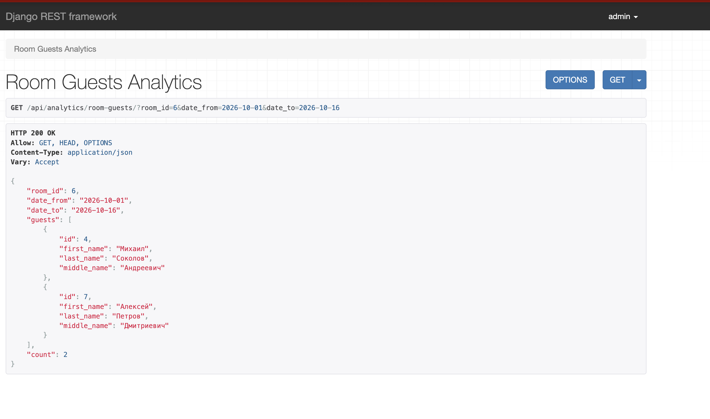

# 6. Аналитические запросы

Я реализовала пять запросов для получения данных о гостях, номерах и уборке.
Все они выполняются методом `GET` и возвращают JSON.

| Запрос | Адрес API и параметры | Результат |
| --- | --- | --- |
| Гости определённого номера за период | `GET /api/analytics/room-guests/` — `room_id`, `date_from`, `date_to` | Список уникальных гостей номера за период и их количество. |
| Количество гостей из города | `GET /api/analytics/guests-by-city/` — `city` | Количество зарегистрированных гостей из указанного города, включая гостей без заселений. |
| Сотрудник, назначенный на уборку этажа гостя | `GET /api/analytics/guest-cleaner/` — `guest_id`, `date` | Номер и этаж проживания гостя на выбранную дату, список назначенных уборщиков. |
| Свободные номера за период | `GET /api/analytics/available-rooms/` — `date_from`, `date_to` | Номера, свободные в течение всего указанного периода, и их количество. |
| Гости, проживавшие одновременно | `GET /api/analytics/concurrent-guests/` — `guest_id` | Гости, чьи проживания пересекались с проживаниями выбранного гостя в гостинице, включая другие номера. |

В расчётах используется фактическая дата выезда, а если она не указана — плановая.
День выезда не входит в период проживания: в этот день номер можно использовать
для нового заселения. Повторяющиеся гости в списках исключаются.

Например, запрос `GET /api/analytics/available-rooms/?date_from=2026-11-01&date_to=2026-11-05`
покажет номера, свободные на весь выбранный период.

*Рисунок 4 — Пример результата аналитического API-запроса.*
