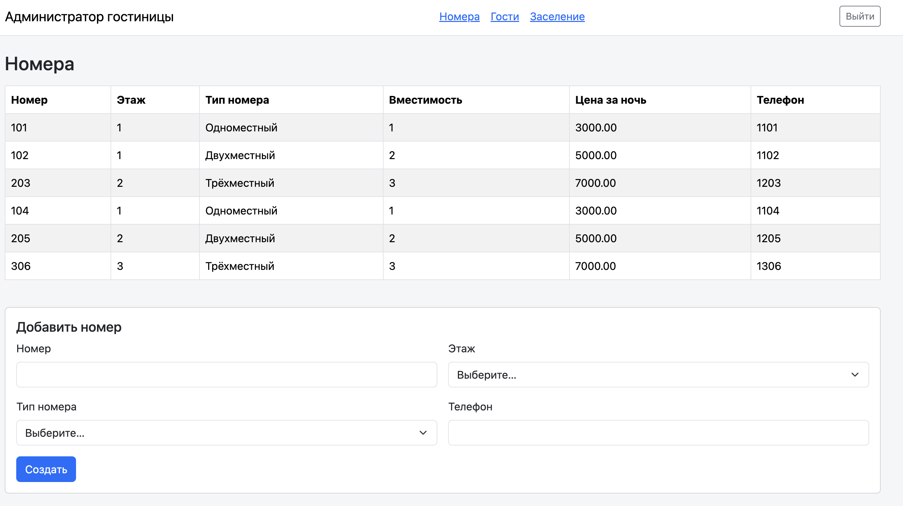
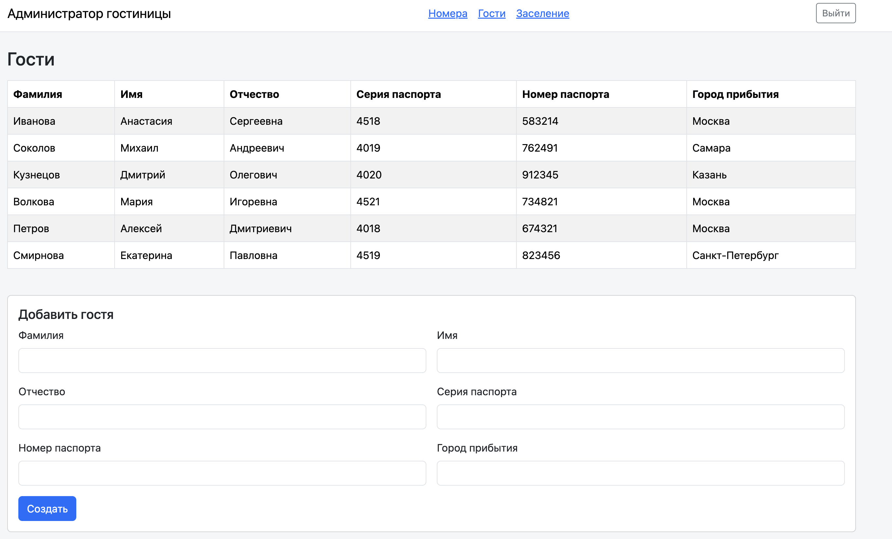
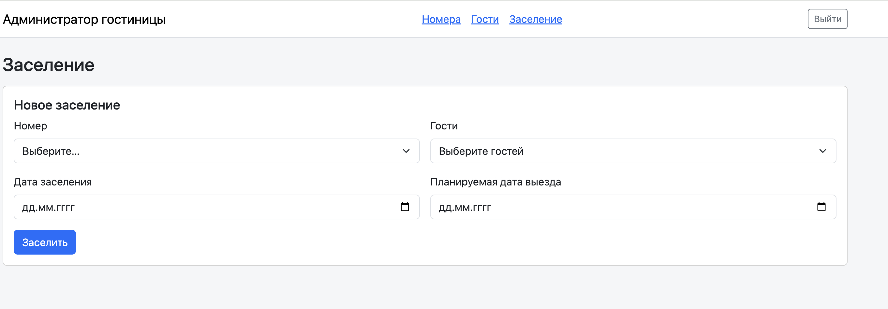
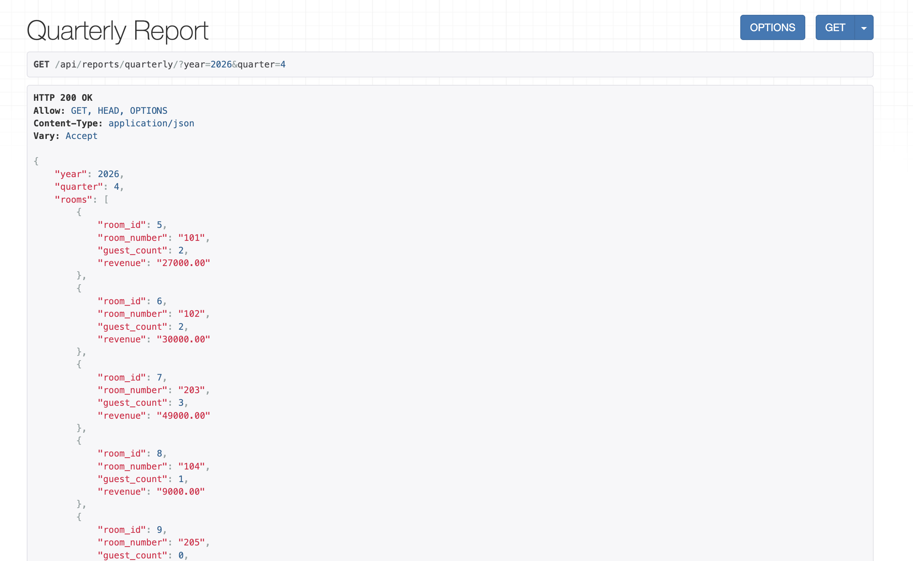

# Лабораторная работа №3 «Администратор гостиницы»

## 1. Цель работы

Цель работы — разработать систему администрирования гостиницы с использованием Django,
Django REST Framework и PostgreSQL. В ходе работы я создала базу данных, REST API
и страницы для основных действий администратора.

## 2. Описание приложения

В приложении `hotel_api` я реализовала управление гостиничными номерами и регистрацию
постояльцев. Система позволяет заселять группы гостей, оформлять выселение, учитывать
сотрудников и составлять расписание уборки этажей. Для получения сводных данных
я добавила пять аналитических запросов и квартальный отчёт.

Для хранения данных использовала PostgreSQL. При заселении система проверяет
вместимость номера, даты и пересечения с другими проживаниями. Тариф сохраняется
в записи заселения, поэтому изменение цены типа номера не меняет стоимость прошлых
проживаний. При выселении записывается фактическая дата выезда, а история сохраняется.

Для работы с гостиницей требуется активная учётная запись с правами сотрудника
(`is_staff=True`). В браузере используется сессия Django, а для запросов к API
также доступна авторизация по токену.

## 3. Модели базы данных

Я разделила данные приложения на восемь основных моделей:

- `RoomType` — тип номера: название, вместимость и цена за ночь.
- `Floor` — этаж гостиницы с уникальным номером.
- `Room` — гостиничный номер, его этаж, тип и телефон.
- `Guest` — ФИО постояльца, паспортные данные и город прибытия.
- `Accommodation` — заселение в номер: дата заезда, плановая и фактическая даты выезда, сохранённый тариф.
- `Stay` — связь конкретного гостя с заселением.
- `Employee` — ФИО сотрудника, даты приёма и увольнения, необязательная связь с учётной записью.
- `CleaningSchedule` — назначение сотрудника на уборку этажа: день недели и период действия.

Каждый номер относится к одному этажу и одному типу. При этом у этажа и типа может
быть несколько номеров. Одно заселение относится к одному номеру, но может включать
нескольких гостей. Через `Stay` гость связан со своими заселениями, что позволяет
хранить историю повторных приездов.

Сотрудники и этажи связаны через `CleaningSchedule`: сотрудник может убирать несколько
этажей, а на одном этаже могут работать разные сотрудники. В расписании я храню
не только день недели, но и даты начала и окончания назначения.

## 4. Реализация REST API

REST API я реализовала с помощью Django REST Framework. Запросы к гостинице имеют
общий префикс `/api/`, данные передаются в формате JSON.

Адреса API ниже приведены как текстовые примеры HTTP-запросов. Они относятся
к запущенному Django-приложению. GitHub Pages публикует только отчёт MkDocs
и не обрабатывает запросы к `/api/`. Для переходов по отчёту используется
оглавление страницы.

Основную реализацию распределила по четырём файлам:

- `models.py` — модели базы данных, связи и ограничения.
- `serializers.py` — проверка входных данных и преобразование данных для API.
- `views.py` — обработка запросов и формирование ответов.
- `services.py` — основная логика заселения, выселения, увольнения сотрудника и расчёта квартального отчёта.

Например, `GET /api/rooms/` возвращает номера, а `POST /api/rooms/` создаёт новый
номер. Запрос `GET /api/guests/` возвращает список гостей, а `POST /api/guests/`
регистрирует гостя. Для сотрудников предусмотрены `GET /api/employees/`
и `POST /api/employees/`. Для отдельных номеров,
гостей и сотрудников доступны просмотр, изменение и удаление по ID с учётом
ограничений приложения.

Заселение выполняется запросом `POST /api/check-in/`. В нём передаются ID номера,
массив ID гостей и даты проживания. Список заселений можно получить через
`GET /api/accommodations/`, а выселение оформить через
`POST /api/accommodations/<id>/check-out/`, указав фактическую дату выезда.
Заселения и связи с гостями доступны для чтения; их создание выполняется через
операцию заселения.

Для просмотра расписания уборки используется `GET /api/cleaning-schedules/`,
для добавления назначения — `POST /api/cleaning-schedules/`, для просмотра
расписания сотрудника — `GET /api/employees/<id>/schedule/`. Увольнение оформляется
через `POST /api/employees/<id>/dismiss/`: система также завершает действующие
и отменяет будущие назначения на уборку.

### Пример результата CRUD-запроса

Пример запроса списка номеров:

```http
GET /api/rooms/
```

В ответе возвращается массив номеров с их ID, этажами, типами и телефонами.

<!-- Место для скриншота ответа на GET /api/rooms/.
Добавить файл docs/images/crud.png и убрать маркеры комментария вокруг вставки ниже.


Рисунок 6 — Результат запроса списка гостиничных номеров через REST API.
-->

## 5. Пользовательский интерфейс

Для повседневных действий я создала три страницы в общем оформлении с помощью
Bootstrap. JavaScript загружает данные через REST API и отправляет формы без
перезагрузки страницы. Результат операции или ошибка отображаются сообщением.

### Номера

На странице `/` выводится таблица номеров с этажом, типом, вместимостью, ценой за ночь
и телефоном. Ниже расположена форма добавления номера. Этажи и типы загружаются
из API; перед созданием номера эти справочники должны быть заполнены.



*Рисунок 1 — Страница гостиничных номеров.*

### Гости

На странице `/guests/` я разместила список постояльцев и форму регистрации.
В форме указываются ФИО, серия и номер паспорта, а также город прибытия.
После сохранения список гостей обновляется.



*Рисунок 2 — Страница постояльцев.*

### Заселение

На странице `/check-in/` выбираются номер, гости, дата заезда и плановая дата выезда.
Для выбора нескольких гостей я добавила выпадающий список с чекбоксами и поиском
по ФИО. Выбор выполняется обычными кликами, а закрытое поле показывает количество
выбранных гостей. При отправке формы API получает массив их ID.

После успешного заселения форма очищается. Вместимость номера, корректность дат
и занятость проверяются на сервере. Выселение, работа с сотрудниками, аналитика
и квартальный отчёт реализованы через API.



*Рисунок 3 — Форма заселения с выбором гостей.*

## 6. Аналитические запросы

Я реализовала пять запросов для получения данных о гостях, номерах и уборке.
Все они выполняются методом `GET` и возвращают JSON.

| Запрос | Адрес API и параметры | Результат |
| --- | --- | --- |
| Гости определённого номера за период | `GET /api/analytics/room-guests/` — `room_id`, `date_from`, `date_to` | Список уникальных гостей номера за период и их количество. |
| Количество гостей из города | `GET /api/analytics/guests-by-city/` — `city` | Количество зарегистрированных гостей из указанного города, включая гостей без заселений. |
| Сотрудник, назначенный на уборку этажа гостя | `GET /api/analytics/guest-cleaner/` — `guest_id`, `date` | Номер и этаж проживания гостя на выбранную дату, список назначенных уборщиков. |
| Свободные номера за период | `GET /api/analytics/available-rooms/` — `date_from`, `date_to` | Номера, свободные в течение всего указанного периода, и их количество. |
| Гости, проживавшие одновременно | `GET /api/analytics/concurrent-guests/` — `guest_id` | Гости, чьи проживания пересекались с проживаниями выбранного гостя в гостинице, включая другие номера. |

В расчётах используется фактическая дата выезда, а если она не указана — плановая.
День выезда не входит в период проживания: в этот день номер можно использовать
для нового заселения. Повторяющиеся гости в списках исключаются.

Например, запрос `GET /api/analytics/available-rooms/?date_from=2026-11-01&date_to=2026-11-05`
покажет номера, свободные на весь выбранный период.


*Рисунок 4 — Пример результата аналитического API-запроса.*

## 7. Квартальный отчёт

Для квартального отчёта я добавила запрос
`GET /api/reports/quarterly/?year=2026&quarter=4`. Год и квартал передаются
в параметрах, результат возвращается в формате JSON.

Отчёт содержит количество уникальных гостей по каждому номеру, рассчитанную
стоимость проживания по номерам и общую сумму за квартал. Отдельно выводится
количество номеров на каждом этаже, включая этажи без номеров.

Стоимость рассчитывается по сохранённому тарифу и количеству ночей, которые попали
в выбранный квартал. Для группового заселения цена номера учитывается один раз,
а не умножается на количество гостей. Если фактический выезд ещё не оформлен,
используется плановая дата, поэтому сумма является расчётной стоимостью,
а не учётом полученных платежей.



*Рисунок 5 — Квартальный отчёт по гостинице.*

## 8. Вывод

В ходе лабораторной работы я создала систему «Администратор гостиницы» на Django,
Django REST Framework и PostgreSQL. Я научилась связывать модели и хранить историю
заселений гостей и назначений сотрудников на уборку. Реализовала REST API с проверкой
данных и отдельной логикой основных операций. Для работы с номерами, гостями
и заселением создала страницы, которые обращаются к API. Также я закрепила работу
с Django ORM при подготовке аналитических запросов и квартального отчёта.
